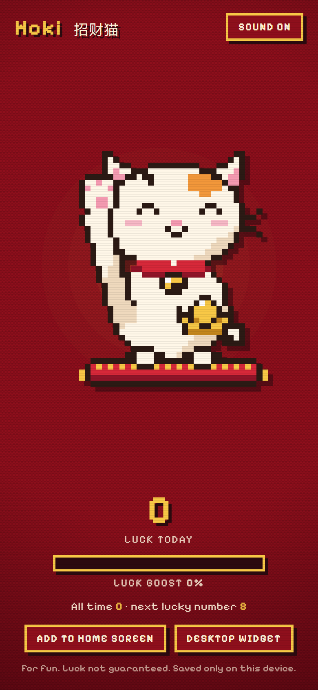

<!-- HERO:START -->
<p align="center">
  <a href="https://juw12.github.io/hoki/"></a>
  
</p>

<p align="center">
  <b>A waving lucky cat (招财猫) for your home screen and desktop.</b><br>
  Tap it for a luck boost. Nothing else, on purpose.
</p>

<p align="center">
  <a href="https://juw12.github.io/hoki/"><b>Try it live</b></a> ·
  <a href="#desktop-widget-windows">Desktop widget</a> ·
  <a href="https://github.com/juw12">More by juw12</a>
</p>

<p align="center">
  <a href="https://juw12.github.io/hoki/"></a>
  
  
  
</p>
<!-- HERO:END -->

## What it does

- The cat waves its paw all day.
- **Tap it**: +1 luck (福 / 财 / 运 / 喜), a bell, coins, and a **luck boost**. Every tap makes the paw wave faster and the glow brighter. The boost fades by half every 6 seconds, so keep tapping.
- **Lucky numbers** (8 发, 28, 88, 168 一路发, 288, 888, 1688, 8888) trigger a big bell and a blessing.
- Counts today and all time. Saved only on your device. No account, no ads, no tracking.

Inspired by the "tap for merit" apps (电子木鱼) and by Sansa (산사), the same spark behind [Jeda](https://github.com/juw12/jeda).

## Home screen (phone)

Open <https://juw12.github.io/hoki/> and add it to your home screen:

- **iPhone (Safari):** Share → *Add to Home Screen*.
- **Android (Chrome):** the *Add to home screen* button in the app, or menu → *Install app*.

It opens full screen and works offline.

> A live, animated, tappable widget *inside* the iOS/Android widget area needs a native app; the system widget APIs don't allow continuous animation. Hoki installs as a home-screen app instead.

`?widget` gives a cat-only view with a transparent background, e.g. for a browser side panel or a live-wallpaper tool: <https://juw12.github.io/hoki/?widget>

## Desktop widget (Windows)

Paste into PowerShell:

```powershell
irm https://juw12.github.io/hoki/desktop/install.ps1 | iex
```

The cat sits on your desktop on the right edge, always on top, with a transparent background.

- **Click** for luck. **Drag** to move.
- **Right-click** for sound, always on top, start with Windows, size (S/M/L), move to corner, and quit.
- No admin rights and no install wizard: it's one PowerShell + WPF script (`desktop/hoki-widget.ps1`) that draws the same `assets/cat.svg` as the web app.
- Files: `%LOCALAPPDATA%\Hoki` (program), `%APPDATA%\Hoki` (your luck + settings), Start menu "Hoki Lucky Cat".
- Uninstall: right-click → Quit, then delete those two folders and the Start menu shortcut.

Without installing: run `desktop/Hoki.cmd` from a checkout.

## Run locally

```powershell
powershell -ExecutionPolicy Bypass -File serve.ps1   # http://localhost:8080
python tools/check_web.py                           # smoke test (Playwright + Edge)
powershell -STA -File desktop/hoki-widget.ps1 -Snapshot out.png -SnapshotTaps 8   # render the widget offscreen
```

`python tools/make_icons.py` rebuilds the app icons from `assets/cat.svg`.

## How it's built

| Part | Files |
|---|---|
| Cat art (shared) | `assets/cat.svg`, generated by `tools/make_pixel_cat.py`: pixel sprite, paw frames `#hoki-paw-0..2` |
| Web / PWA | `index.html`, `css/style.css`, `js/app.js`, `sw.js`, `manifest.webmanifest` |
| Windows widget | `desktop/hoki-widget.ps1`, `desktop/install.ps1`, `desktop/Hoki.cmd` |
| Checks | `tools/check_web.py`, `-Snapshot` mode of the widget |

No build step and no dependencies.

For fun. Luck not guaranteed.

## License

MIT
